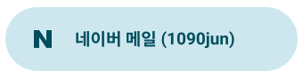
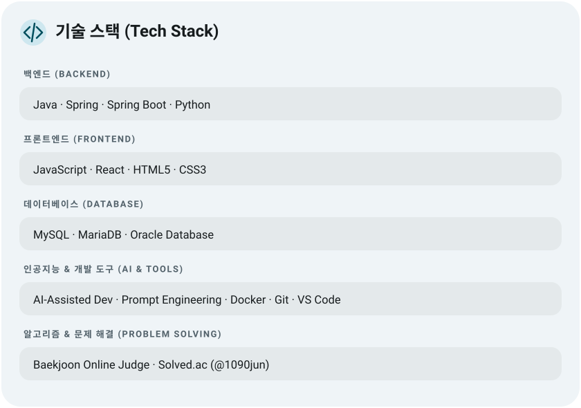
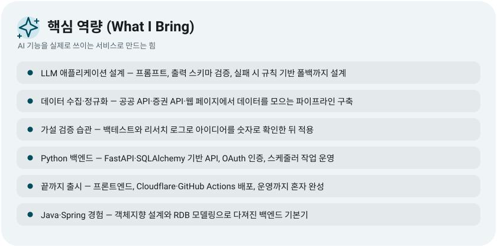
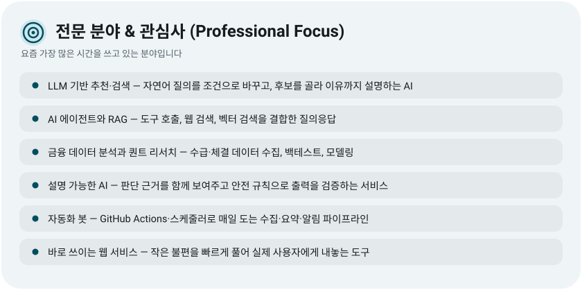
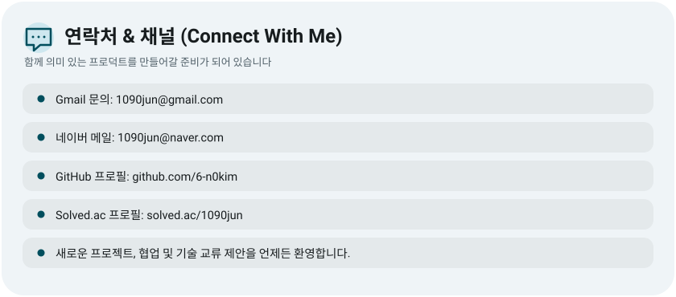
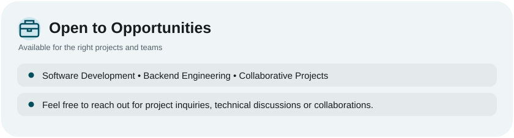
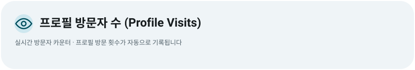

<!-- 1. Hero Banner (Dark / Light Mode) -->
<picture>
  <source media="(prefers-color-scheme: dark)" srcset="assets/hero-dark.svg">
  
</picture>

<!-- 2. Contacts / Badges -->
<a href="mailto:1090jun@gmail.com">
  <picture>
    <source media="(prefers-color-scheme: dark)" srcset="contact-gmail-dark.svg">
    
  </picture>
</a>
&nbsp;&nbsp;
<a href="mailto:1090jun@naver.com">
  <picture>
    <source media="(prefers-color-scheme: dark)" srcset="contact-naver-dark.svg">
    
  </picture>
</a>

<!-- 3. About Me -->
<picture>
  <source media="(prefers-color-scheme: dark)" srcset="./profile-assets/premium-about-dark.svg">
  
</picture>

<!-- 4. GitHub Stats -->
<picture>
  <source media="(prefers-color-scheme: dark)" srcset="assets/stats-dark.svg">
  
</picture>

<!-- 5. Contribution Streak -->
<picture>
  <source media="(prefers-color-scheme: dark)" srcset="assets/streak-dark.svg">
  
</picture>

<!-- 6. Tech Stack -->
<picture>
  <source media="(prefers-color-scheme: dark)" srcset="./tech-stack-dark.svg">
  
</picture>

<!-- 7. What I Bring -->
<picture>
  <source media="(prefers-color-scheme: dark)" srcset="./profile-assets/premium-bring-dark.svg">
  
</picture>

<!-- 8. Professional Focus -->
<picture>
  <source media="(prefers-color-scheme: dark)" srcset="./profile-assets/premium-focus-dark.svg">
  
</picture>

<!-- 9. Connect With Me -->
<picture>
  <source media="(prefers-color-scheme: dark)" srcset="./profile-assets/premium-connect-dark.svg">
  
</picture>

<!-- 10. Open to Opportunities -->
<picture>
  <source media="(prefers-color-scheme: dark)" srcset="./profile-assets/premium-opportunities-dark.svg">
  
</picture>

<!-- 11. Profile Visits -->
<picture>
  <source media="(prefers-color-scheme: dark)" srcset="./profile-assets/premium-visitor-counter-dark.svg">
  
</picture>

<!-- 12. Quick Action Links -->
<a href="https://github.com/6-n0kim?tab=repositories">
  <picture>
    <source media="(prefers-color-scheme: dark)" srcset="./profile-assets/premium-repositories-dark.svg">
    
  </picture>
</a>
&nbsp;
<a href="https://6-n0kim.github.io/capy">
  <picture>
    <source media="(prefers-color-scheme: dark)" srcset="./profile-assets/premium-portfolio-dark.svg">
    
  </picture>
</a>
&nbsp;
<a href="https://solved.ac/1090jun/">
  <picture>
    <source media="(prefers-color-scheme: dark)" srcset="./profile-assets/premium-solvedac-dark.svg">
    
  </picture>
</a>

  

    
  

---

  Design inspired by <a href="https://github.com/ryoaonetsuki">@ryoaonetsuki</a>

