

<picture><source media="(prefers-color-scheme: dark)" srcset="assets/hero-dark.svg"></picture>

<picture><source media="(prefers-color-scheme: dark)" srcset="assets/social-l-dark.svg"></picture><a href="mailto:1090jun@gmail.com"><picture><source media="(prefers-color-scheme: dark)" srcset="assets/social-1-dark.svg"></picture></a><a href="mailto:1090jun@naver.com"><picture><source media="(prefers-color-scheme: dark)" srcset="assets/social-2-dark.svg"></picture></a><picture><source media="(prefers-color-scheme: dark)" srcset="assets/social-r-dark.svg"></picture>

<picture><source media="(prefers-color-scheme: dark)" srcset="assets/about-dark.svg"></picture>

<picture><source media="(prefers-color-scheme: dark)" srcset="assets/stats-dark.svg"></picture>

<a href="https://github.com/jeongeunni/bodymanager_server_real"><picture><source media="(prefers-color-scheme: dark)" srcset="assets/project-bodymanager-server-real-dark.svg"></picture></a>&nbsp;<a href="https://github.com/snowone4426/Body_Manager_server"><picture><source media="(prefers-color-scheme: dark)" srcset="assets/project-body-manager-server-dark.svg"></picture></a>

<a href="https://github.com/6-n0kim/on_spot"><picture><source media="(prefers-color-scheme: dark)" srcset="assets/project-on-spot-dark.svg"></picture></a>&nbsp;<a href="https://github.com/6-n0kim/BaekJoon"><picture><source media="(prefers-color-scheme: dark)" srcset="assets/project-baekjoon-dark.svg"></picture></a>

<a href="https://github.com/6-n0kim/docker-pro"><picture><source media="(prefers-color-scheme: dark)" srcset="assets/project-docker-pro-dark.svg"></picture></a>&nbsp;<a href="https://github.com/6-n0kim/lol.gg"><picture><source media="(prefers-color-scheme: dark)" srcset="assets/project-lol-gg-dark.svg"></picture></a>

<picture><source media="(prefers-color-scheme: dark)" srcset="assets/streak-dark.svg"></picture>

<picture><source media="(prefers-color-scheme: dark)" srcset="assets/wave-dark.svg"></picture>

<picture><source media="(prefers-color-scheme: dark)" srcset="assets/stack-dark.svg"></picture>

<a href="https://github.com/6-n0kim?tab=repositories"><picture><source media="(prefers-color-scheme: dark)" srcset="assets/button-1-dark.svg"></picture></a>&nbsp;&nbsp;<a href="https://6-n0kim.github.io/capy"><picture><source media="(prefers-color-scheme: dark)" srcset="assets/button-2-dark.svg"></picture></a>

<a href="https://metawka.github.io/expressive-profile/?from=6-n0kim"><picture><source media="(prefers-color-scheme: dark)" srcset="assets/credit-dark.svg"></picture></a>

